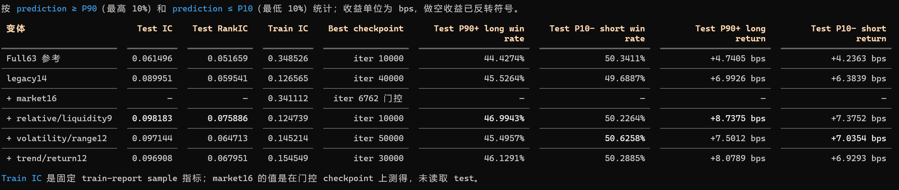

# NN-1min-Ashare-Prediction

### Batch Sampler

- **实验目的：加入截面信息。**
- **方法：1 个 batch 只包含 1 个交易日。**
- 数据：A 股分钟行情，范围 **2021-01-04 至 2024-12-31**。训练截至 2023-12-29，验证截至 2024-02-29，其后为测试集；标准化仅使用训练集拟合。
- 输入与标签：每个样本包含连续 60 根 1 分钟 bar、14 个特征；标签为 log\_close[t+10] - log\_close[t+1]。
- 模型：GruMlpRegressor，两层 GRU、hidden size 384，后接 [512, 512] MLP，输出单个收益预测，约 181 万参数。
- 训练：seed 7，AdamW，学习率 1e-3，batch size 8192，FP16 AMP，单张 GPU，梯度累积为 1。
- 核心改动：每个 batch 只包含一个交易日；交易日按有效序列数加权、有放回抽取；batch 内样本不重复，跨 batch 允许重复。
- 训练预算：总抽样行数等于一轮训练集的有效序列数，即“一个等价 epoch”。
- Checkpoint：每 10,000 step 保存，并保存精确终点 checkpoint；包含模型、优化器、scheduler、AMP scaler 和采样恢复位置。
- **结果：最佳 checkpoint：iter\_30000；测试集 pooled Pearson IC：0.103878；测试集 pooled Rank IC：0.064245**
- 日期：0810

### **截面 features**

- **实验目的：增加截面信息和更长周期 features**
- **方法：增加截面 features**
- 新增特征：在原有 14 个特征基础上追加 49 个特征，总计 63 个。
  - 市场特征：成分股权重构建 CSI300、CSI500、CSI1000 指数分钟收益代理，分别计算 10/60/120/240 分钟收益率和 60 分钟 realized volatility；另计算全市场个股 60 分钟收益率的横截面标准差。
  - 相对特征：个股 60 分钟收益率在同一分钟全市场横截面中的 percentile rank。
  - 流动性 surprise：当前 volume/amount 相对该股票相同日内分钟、过去最多 60 个交易日历史值的分位数，当前日不进入历史窗口，至少需要 20 个历史观测；以及当前 volume/amount 相对前 5/20/60 个连续交易 bar 的分位数。
  - 多尺度状态：新增 realized volatility、range、trend、return 四类状态特征，horizon 为 5/20/60/120/240/480 分钟。保留原有 14 个特征，其中包括 1/2/3/5/10 分钟收益率等短周期特征。
- 数据：A 股分钟行情，范围 **2021-01-04 至 2024-12-31**。训练截至 2023-12-29，验证截至 2024-02-29，其后为测试集；标准化仅使用训练集拟合。
- 输入与标签：每个样本包含连续 60 根 1 分钟 bar、63 个特征；标签为 log\_close[t+11] - log\_close[t+1]。
- 模型：GruMlpRegressor，两层 GRU、hidden size 384，后接 [512, 512] MLP，输出单个收益预测，约 186 万参数。
- 训练：seed 7，AdamW，学习率 1e-3，batch size 8192，FP16 AMP，单张 GPU，梯度累积为 1。学习率调度为 200 step linear warmup，随后 cosine decay，最低学习率 1e-6。
- Batch sampler：随机抽取不放回。
- 训练预算：总抽样行数等于一轮训练集的有效序列数，即“一个等价 epoch”。
- Checkpoint：每 10,000 step 保存，并保存精确终点 checkpoint；包含模型、优化器、scheduler、AMP scaler 和采样恢复位置。
- **结果：最佳 checkpoint：iter\_30000；test pooled Pearson IC：-0.002262；test pooled Rank IC：0.000743。**
- **结果分析 1：泛化问题。**
  - 在第 10,000 step，模型只消费了约 14.8% 的训练行，train IC 已达到 0.35，而 val RankIC 为负。
  - 可能的原因：
    - 5.5 亿样本并不等于 5.5 亿独立样本，同一股票每天约 161 个窗口，相邻输入窗口共享 59/60 根 bar，相邻标签也高度重叠。
    - 模型可能迅速学到了训练期的共同市场和状态模式。每个 batch 几乎覆盖全部 727 个训练日，模型能很快学习训练期的平均关系。尤其是新增特征中包含大量市场收益与市场波动；互相高度相关的多周期 return/trend/range/volatility；长周期状态和流动性状态。
    - 当前 pooled IC 容易被时间和市场共同因子抬高
    - MSE 与最终目标不完全一致。MSE 会更重视大收益和高波动样本。仅做 z-score 并不能消除厚尾，模型容易拟合少数极端状态。
- **结果分析 2：不仅排序关系消失，输出尺度和均值也发生了明显的样本外漂移。**
- **下一步：考虑设置 train–val gap gate，检查灾难性分叉**
  - 条件：10% 样本量训练结束时 train\_val\_rank\_ic\_gap >= 0.15
- **结果分析 3：发现错误**
  - Feature：2024-01-03 起变成 raw scale，因此 validation 有 97.31% 行、test 有 100% 行使用了错误尺度的模型输入。
  - Label：2024-03-12 起变成 raw scale，却仍被当作 z-score 再逆变换。test 有 170,117,430 行、占 96.58% 被错误缩小约 237 倍。
- **修改报告模板、报告生成代码及报告本身：**
  1. 增加 label 分布图，放在 features 分布图之后，单开一小节。
  2. 增加 train global ic 随 checkpoint 变化图
  3. grad norm不要clip p99
- 日期：0811-0812
- **结果：最佳 checkpoint：iter\_10000；test pooled Pearson IC：0.061496；test pooled Rank IC：0.051659；test top 90% long win rate：44.43%；test bottom 10% short win rate：50.34%；test top 90% long return：+4.7405 bps；test bottom 10% short return：+4.2364 bps。**
  - 注：top 90% 指预测值位于第 90 百分位以上的 top 10%；bottom 10% 标的平均收益为 −4.2364 bps，因此做空收益记为正值。

### Feature Ablation

- **实验目的：分组检验 63 个特征的效果**
- **方法：分组分别训练。**
- 分组：
  1. matched control：仅前 14 个旧特征。
  2. 市场环境 16：指数收益 12 + 指数 RV 3 + 市场 dispersion 1
  3. 相对强弱/流动性 9：stock rank 1 + same-minute liquidity 2 + trailing liquidity 6
  4. 波动/区间状态 12：realized-vol 6 + range 6
  5. 趋势/收益状态 12：trend 6 + return 6
- 数据：A 股分钟行情，范围 **2021-01-04 至 2024-12-31**。训练截至 2023-12-29，验证截至 2024-02-29，其后为测试集。
- 输入与标签：每个样本包含连续 60 根 1 分钟 bar、63 个特征；标签为 log\_close[t+11] - log\_close[t+1]；zscore 标准化，仅使用训练集
- 模型：GruMlpRegressor，两层 GRU、hidden size 384，后接 [512, 512] MLP，输出单个收益预测，约 186 万参数。
- 训练：seed 7，AdamW，学习率 1e-3，batch size 8192，FP16 AMP，单张 GPU，梯度累积为 1。学习率调度为 200 step linear warmup，随后 cosine decay，最低学习率 1e-6。
- Batch sampler：全局随机排列，并按该排列无放回取样
- 训练预算：约 727 个交易日 × 每天约 4,700 只股票 × 每只股票每天约 160 个有效窗口 ≈ 5.5 亿个训练序列。batch size 为 8,192，保留最后 4,233 个样本的尾 batch，共有 67,615 个 optimizer step。
- Checkpoint：每 10,000 step 保存，并保存精确终点 checkpoint；包含模型、优化器、scheduler、AMP scaler 和采样恢复位置。
- **结果：**
  - Full63 0.061496 0.051659 0.348526 iter 10000 44.4274% 50.3411% +4.7405 bps +4.2363 bps
  - legacy14 0.089951 0.059541 0.126565 iter 40000 45.5264% 49.6887% +6.9926 bps +6.3839 bps
  - market16 — — 0.341112 iter 6762 门控 — — — — 
  - relative/liquidity9 0.098183 0.075886 0.124739 iter 10000 46.9943% 50.2264% +8.7375 bps +7.3752 bps 
  - volatility/range12 0.097144 0.064713 0.145214 iter 50000 45.4957% 50.6258% +7.5012 bps +7.0354 bps 
  - trend/return12 0.096908 0.067951 0.154549 iter 30000 46.1291% 50.2885% +8.0789 bps +6.9293 bps
    - Train IC 是固定 train-report sample 指标；market16 的值是在门控 checkpoint 上测得，未读取 test。
    - 按 prediction ≥ P90（最高 10%）和 prediction ≤ P10（最低 10%）统计；收益单位为 bps，做空收益已反转符号。

- 日期：0812-0814

### **label 分布和 features 分布研究**

- **label 分布尖峰厚尾、零点堆积、正偏**
  - 约 15-19% 股票在 10 分钟内收盘价没有变化
  - **零样本尖峰：基本是真正的零收益，不是小收益被显示精度或histogram分箱抹成了零。raw label 是精确零。**
    - 全程为 0
    - 波动后回到原价格
  - 零点处不仅有尖峰，两侧还有凹陷和宽肩，可能是由于价格最小跳动单位，一旦价格发生变化，就会变动超过 1 个 tick
  - 厚尾：峰度 23-51
  - train-val-test 存在明显尺度漂移，train 标准差为 1.000，val 标准差为 1.479（2024年2月初），test 标准差为1.189（2024年9月底至10月）
  - P.S.：样本的处理，只保留 60-bar输入窗口有效；63个features全部有限；label有限
  - **影响：**
    - **厚尾对 MSE 的影响很大，3% 的样本对 train MSE 有超过 50% 的贡献。**
    - **零点堆积虽然有 18%，但对 loss 几乎没有影响，对样本数和 batch 组成有影响。**
    - **MSE 实际上在拟合高波动和极端样本，而这部分的 regime 也是最容易变化的。**
  - **建议：尝试Huber loss**

### 重构 **1min 模型代码**

- **仍存在的问题**
- 日期：0812-0816

### **label 尺度改变**

- **实验目的：预测 10min、15min、30min 这三个 label 尺度，对比 IC、胜率的变化**
- **方法：重构 label，共用 features**
- 数据：A 股分钟行情，范围 **2021-01-04 至 2024-12-31**。训练截至 2023-12-29，验证截至 2024-02-29，其后为测试集。
- 输入与标签：每个样本包含连续 60 根 1 分钟 bar、47 个特征；标签为 **log\_close[t+horizon+1] - log\_close[t+1]**；zscore 标准化，仅使用训练集
  - 特征：基础特征 14 + 相对强弱/流动性 9 + 波动/区间状态 12 + 趋势/收益状态 12，即63 个特征 - 市场环境 16（指数收益 12 + 指数 RV 3 + 市场 dispersion 1）
- 模型：GruMlpRegressor，两层 GRU、hidden size 384，后接 [512, 512] MLP，输出单个收益预测，约 186 万参数。
- 训练：seed 7，AdamW，学习率 1e-3，batch size 8192，FP16 AMP，单张 GPU，梯度累积为 1。学习率调度为 200 step linear warmup，随后 cosine decay，最低学习率 1e-6。
- Batch sampler：全局随机排列，并按该排列无放回取样
- 训练预算：约 727 个交易日 × 每天约 4,700 只股票 × 每只股票每天约 160 个有效窗口 ≈ 5.5 亿个训练序列。batch size 为 8,192，保留最后 4,233 个样本的尾 batch，共有 67,615 个 optimizer step。
- Checkpoint：每 10,000 step 保存，并保存精确终点 checkpoint；包含模型、优化器、scheduler、AMP scaler 和采样恢复位置。
- 日期：0814-0816
- **结果**
  - Horizon    Pooled IC    Pooled RankIC     Top10 胜率    Top-Bottom spread
       10min         0.0767           0.0504           41.87%             8.80 bps
       15min         0.0912           0.0675            55.63%             9.68 bps
       30min         0.0904           0.0708            42.36%            12.10 bps
    - 特征统计量只由训练集有限值计算，三个 horizon 完全共享。标签按 horizon 独立计算，并分别使用训练集监督端点做 z-score. 

### Cross day 跨日处理

- **实验目的：测试跨日期的 rolling 怎么计算比较好，是按照 close-open 拼接这一段比较好，还是删除比较好，还是接受这里有跳空比较好**
- **方法：跳空** g\_d=\\log(Open\_d)-\\log(Close\_{d-1})
  - 
- 数据:A股分钟行情，范围2021-01-04至2024-12-31。训练截至2023-12-29，验证截至2024-02-29，其后为测试集。
  输入与标签: 每个样本包含全市场股票，连续60根1分钟bar, 47个特征;标签为log\_close[t+11]- log\_close[t+1];zscore 标准化，仅使用训练集
  模型:GruMlpRegressor,两层 GRU,hidden size 384,后接[512,512]MLP,输出单益预测，约186万参数。
  训练:seed 7,AdamW,学习率1e-3,batch size 8192,FP16 AMP,单张GPU,梯度累积为1。学习率调度为200 step linear warmup,随后cosine decay,最低学习率1e-6 Batch sampler:全局随机排列，并按该排列无放回取样
  训练预算:约727个交易日x每天约4,700只股票x每只股票每天约160个有效窗口。batch size为8,192，保留最后零散个样本的尾batch，共有？个 optimizer step
  Checkpoint:每10,000 step保存，并保存精确终点checkpoint;包含模型、优化器、 scheduler、AMP scaler复位置。

- **实验目的：修改样本定义，每个样本包含全市场**
- 数据:A股分钟行情，范围2021-01-04至2024-12-31。训练截至2023-12-29，验证截至2024-02-29，其后为测试集。
  输入与标签: 每个样本包含全市场股票，连续60根1分钟bar, 47个特征;标签为log\_close[t+11]- log\_close[t+1];zscore 标准化，仅使用训练集
  模型:GruMlpRegressor,两层 GRU,hidden size 384,后接[512,512]MLP,输出单益预测，约186万参数。
  训练:seed 7,AdamW,学习率1e-3,batch size 8192,FP16 AMP,单张GPU,梯度累积为1。学习率调度为200 step linear warmup,随后cosine decay,最低学习率1e-6 Batch sampler:全局随机排列，并按该排列无放回取样
  训练预算:约727个交易日x每天约4,700只股票x每只股票每天约160个有效窗口。batch size为8,192，保留最后零散个样本的尾batch，共有？个 optimizer step
  Checkpoint:每10,000 step保存，并保存精确终点checkpoint;包含模型、优化器、 scheduler、AMP scaler复位置。

- **Prefect 工作流设计**

### 想法

0810：

- 修改 features，加入更长周期的 features

0811：

- 测试 label（close-close; vwap-vwap）；log close[t+11] - log close[t+1]
- 测试：拼接开盘；去掉开盘

0812

- 在研究报告中加入正确性可视化约束：train/val/test 的标准化对比
- 研究报告中所有位置加入胜率
- GRU MLP CNN Transformer，基本的 block 只有这些，考虑组合以增加模型参数量

0813

- loss function 很重要，一定要调整
- 涨停幅度 10% 和 20% 样本是否要分开？
- 保管结果很重要，检查保管过程；gitlab 远程提交

0814

- prefect 调度
- push 笔记到远程
- 全局 qmodel-run/qmodel-submit 的 editable 映射确实已失效
